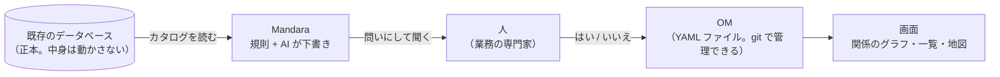
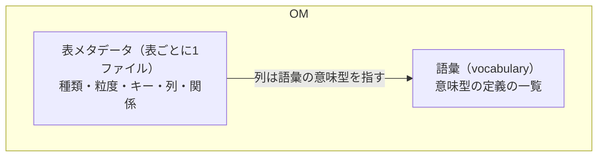
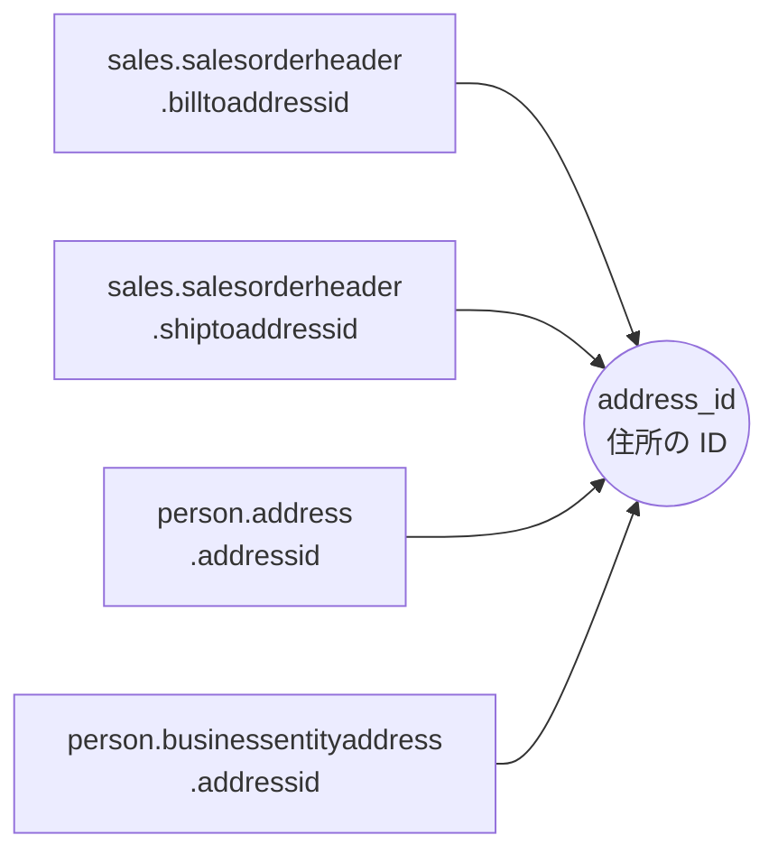
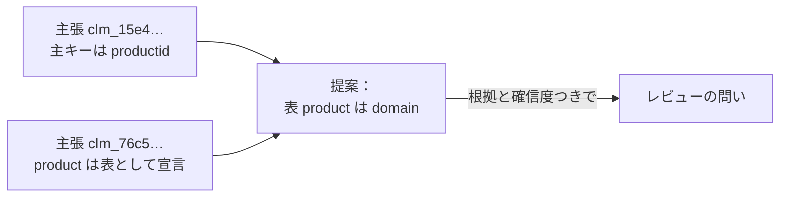
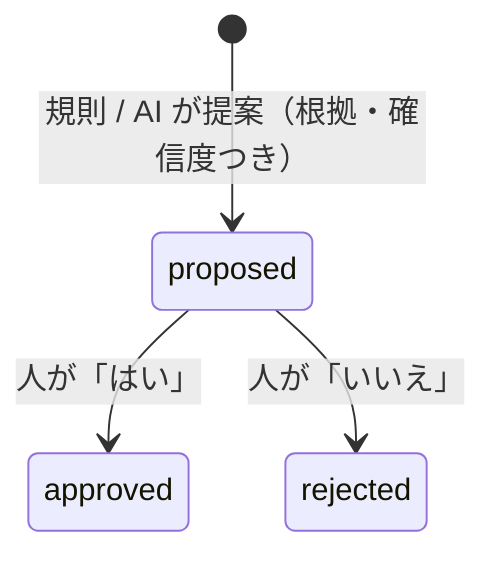
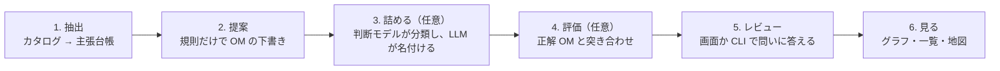
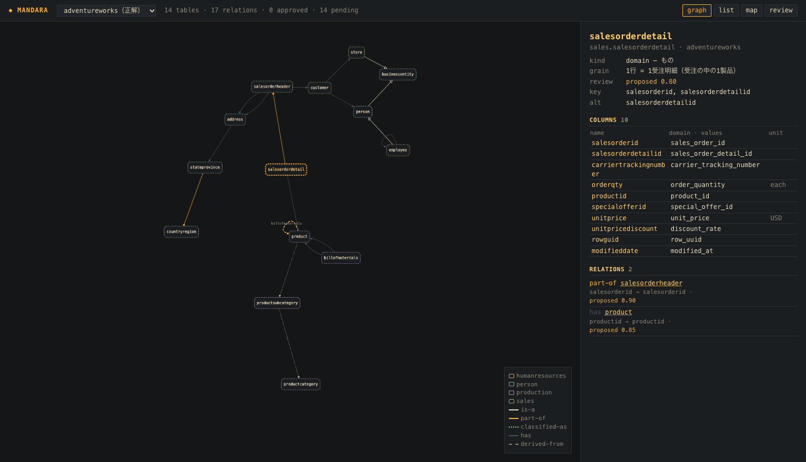
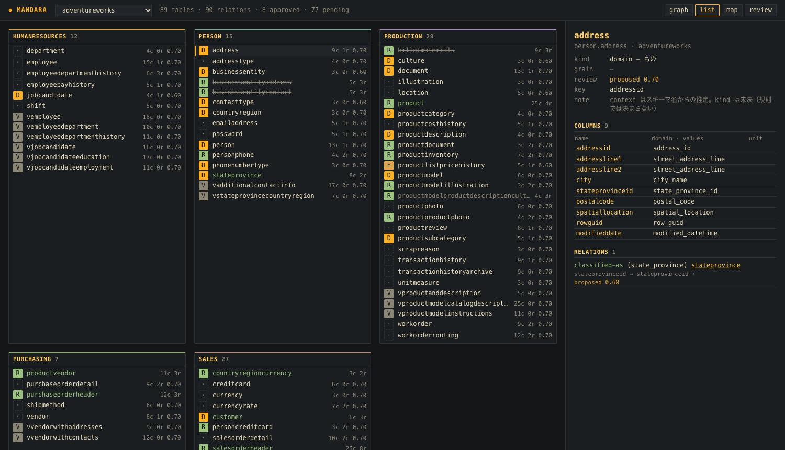
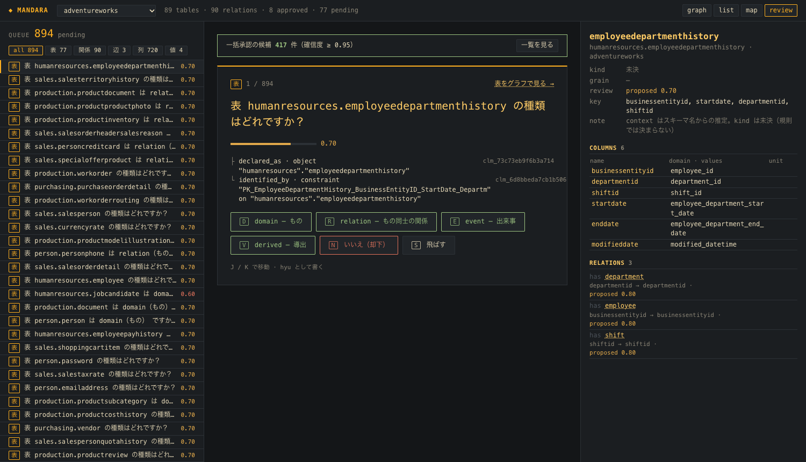

# Mandara クイックスタート

> **ひとことで**：データベースを読んで、「この表・この列は何を意味しているか」を AI が下書きし、人が「はい / いいえ」で確かめ、その結果を地図やグラフで見られるようにする道具です。

このガイドでは、まず考え方を絵で説明し（2 章）、そのあとサンプルデータ（自転車メーカーの業務 DB、AdventureWorks）で一通り動かします（4〜6 章）。動かすだけなら 4 章から読んでも大丈夫です。

> 状態：2026-10 時点の第一弾です。読めるのは PostgreSQL、AI は Claude を使います。全体の構想は [Mandara-spec.md](../Mandara-spec.md) にあり、このガイドは **今動く範囲** だけを扱います。

---

## 1. 何をする道具か

業務データベースには、たいてい表と列の名前しかありません。`salesorderdetail.unitprice` が「税抜きの単価（米ドル）」で、`productid` が製品表の `productid` と同じ物を指す、といった **意味** は人の頭の中か、散らばった文書の中にしかありません。

Mandara は、その意味を **オントロジカルメタデータ（OM）** という形で起こします。



大事な約束が3つあります。

| 約束 | 意味 |
|---|---|
| **AI は提案だけ** | AI が書くのは `proposed`（提案中）まで。`approved`（承認）にできるのは人だけです |
| **根拠を必ず添える** | 提案には、それを言える根拠（下で説明する「主張」）と確信度を付けます。根拠の無い提案は捨てます |
| **データはコピーしない** | Mandara が持つのはメタデータ（意味の注釈）だけです。業務データは元の DB に置いたまま、必要なときに読みます |

---

## 2. 概念

### 2.1 OM（オントロジカルメタデータ）

表や列に付ける **意味の注釈** の集まりです。中身は大きく2つあります。



例として、受注明細の表を OM で表すと次のようになります（抜粋）。

```yaml
name: sales.salesorderdetail
kind: domain                          # 表の種類（2.2）
grain: 1行 = 1受注明細（受注の中の1製品）   # 1行が何を表すか
identity:
  primary: [salesorderid, salesorderdetailid]
columns:
  productid: { semantic_type: product_id }                       # 「製品の ID」という意味（2.3）
  unitprice: { semantic_type: unit_price, unit: { fixed: USD } } # 単価で、単位は米ドル
relations:
  - type: part-of                     # 明細は受注の「部分」（2.4）
    target: sales.salesorderheader
    via: [{ from: salesorderid, to: salesorderid }]
```

つまり、「明細の `productid` は製品の ID」「`unitprice` はドル建ての単価」「明細は受注の一部」といった、**人なら知っているけれど DB には書いていないこと** を、機械が読める形で書き留めたものです。

### 2.2 表の種類（kind）

表の1行が **何を表すか** を3つに分けます。

| 種類 | 意味 | 例 |
|---|---|---|
| **domain** | 「もの」。名前で指せて、状態が変わりうる | 製品、顧客、住所、受注 |
| **event** | 「出来事」。起きたら変わらない、記録が積み上がる | 価格の変更履歴、操作ログ |
| **relation** | 「もの同士のつなぎ」。多対多（N:N）の中間表 | 部品表（どの製品にどの部品が入るか） |

- **1:N のつながりは表の種類ではありません。** 子の表が外部キーを持てば済むので、表と表の **関係**（2.4）として書きます（明細 → 受注は part-of）。中間表が要るのは N:N のときだけなので、relation はその表のための種類です
- **ビューのような計算された表** は、種類とは別に `derived: true` という印を付けます。何を表すか（種類）と、どう作られたか（実体の表か、計算か）は別の話だからです。たとえば、人と従業員を結合しただけのビューは「domain で derived」です。derived の表には書き込めません

規則だけで決まるもの（主キーが2本の外部キーの組なら relation、ビューなら derived、など）は自動で決め、決まらないものは **未決** のまま人に聞きます。

### 2.3 意味型（同じ意味の列をまとめる）

**意味型**（semantic type）は「列の値が何を意味するか」の名前です。値の型（識別子、コード、金額、日付…）と説明を持ちます。

ポイントは、**別の表の列でも、意味が同じなら同じ意味型にする** ことです。たとえば「A 表の C 列と B 表の D 列は、どちらも住所の ID」。



同じ意味型の列同士は、結合したり、同じ物として扱ったりできます。識別子の意味型は、表と表の関係を見つける手がかりにもなります。逆に、「識別子」という値の型だけでまとめてしまうと、製品の ID と住所の ID が同じ扱いになって意味が壊れます。だから Mandara は、`identifier` のような **値の型の名前を意味型の名前にすることを禁止** しています。識別子以外も同じで、受注日と出荷日は同じ日付型でも別の意味型です。

**外部キーは確かな手がかりです。** 外部キーの列は参照先の列と同じ物を指すので、外部キーをたどってつながる列は、必ず同じ意味型になるようにしています（AI がその1か所に名前を付ければ、組の残りの列にも同じ意味型が付きます）。

> 用語の注意：表の種類の **domain**（もの）と、意味型は別物です。意味型は DDD でいう値オブジェクトの型に近いものです。

### 2.4 関係の型

表と表のつながりにも意味を付けます。

| 型 | 読み方 | 例 |
|---|---|---|
| **has** | 〜を参照する・〜を持つ | 明細は製品を参照する |
| **part-of** | 〜の部分である | 明細は受注の部分、州は国の部分 |
| **is-a** | 〜の一種である（主キーを共有する） | 従業員は人の一種 |
| **classified-as** | 〜に分類される | 製品はサブカテゴリに分類される |
| **derived-from** | 〜から導出される | ビューは元の表から |

### 2.5 主張と主張台帳（根拠）

**主張** は「ソースがこう言っている」という1つの事実です。例：「`salesorderdetail` の主キーは (`salesorderid`, `salesorderdetailid`)」「`productid` は `product.productid` を参照する（外部キー）」。

カタログ（DB の定義情報）から読んだ主張は **主張台帳** に集め、1件ずつ ID（`clm_…`）を振ります。OM の提案は、どの主張を根拠にしたかを ID で持ちます。だから、レビューのときに「なぜそう言えるのか」を辿れます。



### 2.6 提案とレビュー

OM の注釈（表・列・関係…）はどれも **状態** を持ちます。



- 提案は **問いの形** で出ます。差分を読ませるのではなく、「列 X は address_id（住所の ID）ですか？」に答えてもらいます
- 確信度が 0.95 以上の提案は、**一覧で見てからまとめて承認** できます
- 一度人が判断したものは、AI が再実行しても上書きしません

### 2.7 正解 OM と評価

サンプルデータには、人が作った **正解 OM**（AdventureWorks の 14 表）があります。Mandara の提案を正解と突き合わせ、「主キーを何割当てたか」「同じ意味の列の組を何割当てたか」などを点数にします。AI や規則を変えたときに、良くなったか悪くなったかを数字で確かめるためのものです。

---

## 3. 全体の流れ



1〜4 は `mandara run` 一発で回ります。5 と 6 は画面で行います。

---

## 4. 準備

### 必要なもの

| もの | 用途 |
|---|---|
| PostgreSQL 17 | サンプルデータを入れる |
| [uv](https://docs.astral.sh/uv/) | Python（3.13 以上）の環境と依存 |
| [pnpm](https://pnpm.io/) と Node.js | 画面 |
| Anthropic と TypeSafe の API キー | AI で詰める段（3）を使うときだけ。名前と文は Anthropic の LLM、分類は TypeSafe の判断モデル（Jev） |

### サンプルデータを入れる

自転車メーカーの業務 DB（AdventureWorks、5 スキーマ・68 表）を、ローカルの PostgreSQL に `adventureworks` という名前で作ります。

```sh
evals/datasets/adventureworks/load.sh
```

### 依存を入れる

```sh
uv sync
(cd ui && pnpm install)
```

### AI を使うなら：API キー

```sh
cp .env.example .env
# .env の ANTHROPIC_API_KEY= と TYPESAFE_API_KEY= に API キーを書く（.env は git に乗らない）
uv run mandara llm-check     # 両方の接続を1回ずつ確かめる（費用はごくわずか）
```

AI の段は、問いを2種類に分けています。

- **分類**（表の種類、関係型、どの意味型か、値の型、役割、加法性、単位）：選択肢を決めて、判断モデル（Jev）に問います。答えは選択肢ごとの確率で返り、選んだ選択肢の確率がそのまま確信度になります。0.6 未満や「決められない」は提案せず、理由を記録します
- **生成**（新しい意味型の名前と説明、enum のラベル、grain の文）：LLM に問います。分類で「新しい意味」となった列や、grain が要る表のときだけ問います

`.env` では、モデル（LLM は既定 `claude-haiku-5-5`、判断モデルは `jev-1.13.0` に版を固定）と **1 回の実行の予算の上限**（例の値は 20 円。2 つのモデルの合計）を決めます。上限を超えそうになると、問うのを止めて残りは規則だけの提案のまま残します。黙って安いモデルに切り替えたりはしません。

---

## 5. 動かす

### 5.1 解析する

```sh
uv run mandara run --source adventureworks --conninfo dbname=adventureworks \
  --schema humanresources --schema person --schema production --schema purchasing --schema sales \
  --gold evals/datasets/adventureworks/gold/ontology \
  --llm          # AI で詰めないなら外す（規則だけなら数秒、費用なし）
```

出力の例（AI あり）：

```
◆ MANDARA  adventureworks  humanresources person production purchasing sales
  extract   89 objects → 2,241 claims
  propose   89 tables (relation 12 · undecided 77; derived 21) · 90 relations
  refine    refined 89  jev-1.13.0 + claude-haiku-5-5  ¥13.06 / ¥20
  evaluate  vs evals/datasets/adventureworks/gold/ontology
            primary_key          ████████████████████   14/14   err 0%
            semantic_type_pairs  ██████████████████··  207/234  err 1%
            ...
  record    work/adventureworks/runs/20261016T151249049509Z.json
```

結果は `work/adventureworks/` に書かれます（git には乗せません）。

### 5.2 画面を立てる

ターミナルを2つ使います。

```sh
# 1つ目：API（--reviewer の名前で、承認・却下を書く。付けなければ読むだけ）
uv run mandara serve --reviewer あなたの名前 \
  --gold adventureworks=evals/datasets/adventureworks/gold/ontology \
  --connect adventureworks dbname=adventureworks

# 2つ目：画面
cd ui && pnpm dev
```

ブラウザで http://127.0.0.1:5173/ を開きます。左上で OM を選びます（`adventureworks` が今回の提案、`adventureworks（正解）` が正解 OM）。

**開発用：全部承認。** `serve` に `--dev` を付けると、レビュー画面に「全部承認…」が出ます。種類を選ぶ表を除く、まだ判断していない提案をすべて承認します。中身を見ずに承認済みとして固定するので、承認済みの状態を試すときだけに使います。やり直すときは `work/adventureworks` を消して `mandara run` から作り直します。

---

## 6. 画面の見方

右上の **graph / list / map / review** で表示を切り替えます。表を選ぶと、右側に表の詳細（種類、粒度、レビューの状態、キー、列と意味型、関係）が出ます。

### graph：関係のグラフ

表を点、関係を線で描きます。線の形と色が関係の型（part-of は菱形の矢印、is-a は白抜きの矢印…）、枠の色がコンテキスト（スキーマ）です。破線の枠はまだ提案中の表です。



### list：一覧

コンテキストごとに表を並べます。左の印が種類（**D** domain、**E** event、**R** relation、**·** 未決。derived の表は名前が斜体）、右が列数・関係数・確信度です。承認した表は緑、却下した表は取り消し線で出ます。



### map：地図

意味の型が地点（`geo.point`）の列があれば、その値を地図に描きます。AdventureWorks では住所の位置（`person.address.spatiallocation`、約 2 万点）が出ます。地図を出すには、`serve` に `--connect` でデータベースの接続を渡します（値はそのとき DB から読み、Mandara 側には保存しません）。

### review：レビュー

提案に問いの形で答える画面です。



| 場所 | 中身 |
|---|---|
| 左 | 問いの列。影響の大きい順（表 → 関係 → 列 → 値）。上のボタンで対象を絞れる |
| 中央 | 今の問い。確信度、根拠（主張）を3行まで |
| 右 | 問いの表の詳細。答えるたびに更新 |
| 上の緑の帯 | 一括承認の候補（確信度 0.95 以上）。「一覧を見る」で中身を確かめてから承認する |

キー操作：

| キー | 操作 |
|---|---|
| `Y` | はい（承認） |
| `N` | いいえ（却下） |
| `S` | 飛ばす |
| `D` / `R` / `E` | 種類が未決の表を、その種類で承認（domain / relation / event） |
| `J` / `K` | 次 / 前の問いへ |

答えはその場で OM のファイルに書かれます（途中でやめても、そこまでの判断は残ります）。当てられない答え（たとえば「粒度の書かれていない表を event にする」）は、理由を出して受け付けません。選び直してください。

CLI でも同じことができます（同じ処理を通るので、結果は画面と同じです）。

```sh
uv run mandara review --source adventureworks --reviewer あなたの名前
uv run mandara review --source adventureworks --reviewer あなたの名前 --bulk 0.95   # 一括承認
```

---

## 7. ファイルの置き場所

```
work/adventureworks/          … 自動で作るもの（git に乗せない）
├── claims/                   … 主張台帳
├── ontology/                 … 提案した OM（レビューの答えもここに書かれる）
│   ├── vocabulary.yaml       … 語彙（意味型）
│   └── contexts/<スキーマ>/tables/<ソース>/<表>.yaml
├── eval/report.json          … 正解との突き合わせ
└── runs/<時刻>.json           … 実行の記録（AI の答え、費用、捨てた提案とその理由）

evals/datasets/adventureworks/gold/ontology/   … 正解 OM（人が作ったもの）
```

OM はふつうの YAML なので、エディタで読めて、git で差分を取れます。

---

## 8. いまの実力（AdventureWorks の正解 14 表に対して）

「正解 / 正解の数」です。規則だけでも、キーやつながりは DB の定義から確実に取れます。意味（種類や意味型）は AI が入って初めて埋まります。

| 観点 | 規則だけ | 規則 + AI（予算 20 円、使ったのは 13 円） |
|---|---|---|
| 主キー | 14/14 | 14/14 |
| 関係の端点（どの列でつながるか） | 15/17 | 15/17 |
| 関係の型 | 8/15 | 13/15 |
| 表の種類 | 0/14 | 11/14（誤り 15%） |
| 列の値の型 | 0/141 | 120/141（誤り 4%） |
| 同じ意味の列の組（意味型） | 0/234 | 207/234（誤り 1%） |
| grain（1 行が何か） | 0/5 | 3/5 |

AI の段は 89 表すべてに問うて 13 円でした。表の種類の誤りは、受注（ヘッダと明細）を event と判定したもの（正解は domain）です。部品表は種類を決められず（正解は relation）、提案していません。点数の履歴は [docs/backlog.md](backlog.md) にあります。

---

## 9. 困ったとき

| 症状 | 理由と対処 |
|---|---|
| `mandara run` が「人の判断を含む OM は…」と止まる | 一度でも承認・却下した OM は、再実行で上書きしません（人の判断を守るため）。最初からやり直すなら `work/adventureworks` を消してから回します。判断を残したままの再実行は今後の課題です |
| 画面に「読むだけ」と出る | `serve` に `--reviewer 名前` を付けて立て直します |
| 地図に「接続が無い」と出る | `serve` に `--connect adventureworks dbname=adventureworks` を付けます |
| AI の段が途中で止まる | 予算の上限です。実行の記録（`runs/*.json`）に、どこで止まり、どの表を問わなかったかが残ります。`.env` の `MANDARA_BUDGET_JPY` で上限を変えられます |
| 提案が捨てられている | 根拠の無い提案や、検証を通らない提案は、理由つきで捨てます。理由は実行の記録の `dropped` にあります |

---

## 10. まだできないこと

- PostgreSQL 以外のソース、外部キーが宣言されていない DB での関係の推定
- 承認したときに何が起きるかの予告（「承認すると地図が付きます」など）、食い違う提案からの選択
- 「別の意味です」という答え（いまは はい / いいえ だけ）
- 判断を残したままの再実行
- 構想にある、OM からのプログラミングインターフェースやセマンティックモデルの生成（[仕様書](../Mandara-spec.md) の 7 章以降）
